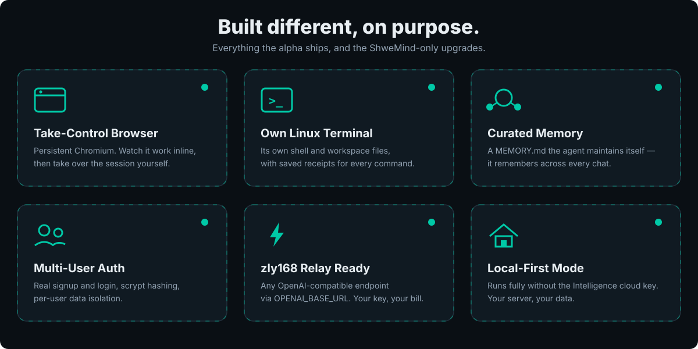

<div align="center">



[](LICENSE)
[](docs/SETUP.md#configure-the-agent-and-google)
[](docs/FEATURES.md)
[](docs/RICH-THREADS.md)
[](docs/MEMORY.md)

**ShweMind is a personal AI agent with its own computer — ask for an outcome, follow the plan, review actions, and come back to the result.**
Built with CopilotKit React Native for iOS, Android, and web.

> Forked from [CopilotKit/OpenMuse](https://github.com/CopilotKit/OpenMuse) (MIT) and rebuilt for real-world use: zly168 relay support, optional Intelligence (local-first mode), real multi-user auth, curated memory, Burmese locale scaffolding.

[What it does](#what-shwemind-does) · [How to use](#how-to-use) · [Why ShweMind](#why-shwemind) · [Docs](docs/README.md)

[](https://render.com/deploy?repo=https://github.com/mymyanmarland/shwemind)

</div>

> **Alpha, for self-hosting and building on.** See the [roadmap](ROADMAP.md).

## What ShweMind does

Tell it the outcome. It handles the rest — ShweMind runs its **own computer**: a persistent Chromium browser you can watch inline and **take control of** mid-task, a Linux terminal with saved receipts for every command, and workspace files it edits for you. Tasks are durable (pause, resume, retry), goals keep watch while you're away, and the agent maintains its own curated memory across every chat.

<p align="center">

</p>

## How to use

**Requirements:** Node 24 LTS, pnpm 11.19.0, and a model key — any OpenAI-compatible endpoint works (e.g. zly168).

```sh
git clone https://github.com/mymyanmarland/shwemind.git shwemind
cd shwemind
pnpm install --frozen-lockfile
cp .env.example .env   # set MODEL, OPENAI_API_KEY, OPENAI_BASE_URL
pnpm dev               # API on :8787
pnpm dev:web           # open localhost:8081
```

Full guide — model config, Google OAuth, browser worker, Render deploy: [docs/SETUP.md](docs/SETUP.md).

## Why ShweMind

- **Watches and takes over a real browser** — persistent Chromium profiles, visible inline in chat, "Take control" anytime.
- **Own Linux computer** — terminal with saved receipts, editable workspace files.
- **Remembers you** — curated memory across every chat, maintained by the agent itself.
- **Multi-user ready** — real signup/login with per-user data isolation, not a shared key.
- **Any model relay** — `OPENAI_BASE_URL` points at zly168 or any OpenAI-compatible endpoint.
- **Local-first** — runs fully without CopilotKit's cloud; the Intelligence key is optional.

<p align="center">

</p>

<details>
<summary>How it flows</summary>
<p align="center">

</p>
</details>

## Learn more

- [Setup guide](docs/SETUP.md) — full quick start, deploy, Google OAuth, browser worker
- [Features](docs/FEATURES.md) · [Demos](docs/DEMO.md) · [Architecture](docs/ARCHITECTURE.md)
- [Contributing](CONTRIBUTING.md) · [Roadmap](ROADMAP.md)

MIT licensed. Issues and pull requests are welcome.
